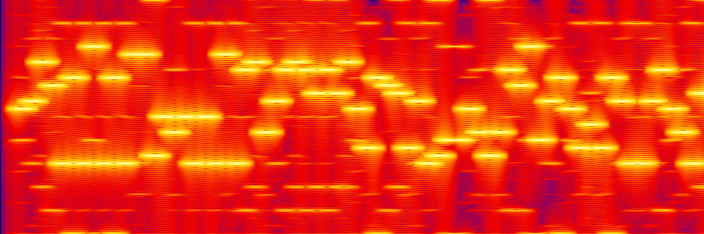

# WavStore

Store any file as sound.

WavStore takes a file and turns it into a `.wav` made up of pure sine waves. It can then decode that audio and recover the original file. Each byte is represented by two tones, with each tone encoding 4 bits.




*Spectrogram of `samples/encoded.wav`.*

## Try it in two minutes

### 1. Download

Download the executable for your system from the [latest release](https://github.com/rodrigo4405/WavStore/releases/latest).

| System | File |
|---|---|
| Windows | `wavstore-windows.exe` |
| macOS | `wavstore-macos` |
| Linux | `wavstore-linux` |


- **Windows:** SmartScreen may warn you because the application is unsigned. Click **More info → Run anyway**.
- **macOS:** If the application is blocked, right-click it and select **Open**.
- **Linux:** Make the file executable first:

```bash
chmod +x wavstore-linux
```

### 2. Try the demo

There's already a file hidden inside `samples/demo.wav`. To get it back, run:

```bash
wavstore decode samples/demo.wav -o recovered/
```

### 3. Encode a file

You can encode any file and then decode it again:

```bash
wavstore encode myfile.pdf -o out/
wavstore decode out/encoded.wav -o back/
```

### 4. Check the result

To make sure everything worked, compare the original file with the recovered one:

```bash
wavstore compare myfile.pdf back/myfile.pdf
```

This compares their SHA-256 hashes and tells you whether the files are identical.

## How it works

The encoding process has five steps:

1. **Pack:** A small header is added to the file. It contains the magic bytes (`WVST`), the filename length, the file size and the filename itself.
2. **Compress:** The header and file data are compressed together using `zlib` (level 9).
3. **Split:** Each byte is split into two 4-bit halves (nibbles), with values from 0 to 15.
4. **Encode:** Each nibble is turned into a sine wave with a fixed duration. Its frequency is calculated using `nibble × STEP + START`.
5. **Write:** All the tones are joined together and saved as a mono, 8-bit WAV file.

Decoding works in reverse. The WAV is split into segments, an FFT finds the strongest frequency in each one, and that frequency is converted back into a nibble. Pairs of nibbles are joined into bytes, which are then decompressed and unpacked to recover the original file.

### File header

Before compression, the file is packed with a small header:

| Field | Size | Description |
|---|---|---|
| Magic | 4 bytes | Format identifier (`WVST`) |
| Filename length | 1 byte | Length of the filename |
| Data length | 4 bytes | Size of the original file |
| Filename | Variable | Original filename |
| Data | Variable | Original file contents |

## Capacity

Each tone carries 4 bits and lasts 0.075 seconds.

Each byte is encoded using two tones, taking 0.15 seconds per byte. This gives a speed of approximately **6.67 bytes per second**.

The WAV file size can be estimated with:

```
compressed bytes × 2 × SAMPLE_RATE × DURATION
```

Currently it's about **448 bytes per compressed byte**.

## Configuration

The encoding parameters are defined in `src/codec.py`. Both the encoder and decoder need to use the same values, since only the sample rate is stored in the WAV file.

| Constant | Description | Current value |
|---|---|---|
| `N_TONES` | Number of different tones | 16 |
| `START` | Frequency of the first tone (Hz) | 445 |
| `STEP` | Frequency difference between tones (Hz) | 50 |
| `DURATION` | Duration of each tone (seconds) | 0.075 |
| `SAMPLE_RATE` | Samples per second (`round(2.5 × F_MAX)`) |  |


## Run from source

You'll need **Python 3.14** and the packages listed in `requirements.txt`:

- `numpy`
- `soundfile`
- `tqdm`
- `music`

Clone the repository and install the dependencies:

```bash
git clone https://github.com/rodrigo4405/WavStore.git
cd WavStore
pip install -r requirements.txt
```

You can then run the commands directly through Python:

```bash
python src/main.py encode <input-file> -o <output-dir>
python src/main.py decode <input.wav> -o <output-dir>
python src/main.py compare <original-file> <recovered-file>
```

## Project structure

```text
WavStore/
├── .github/
│   └── workflows/
│       └── release.yml     # Builds executables for Windows, macOS and Linux
├── docs/
├── samples/
|   ├── ...
│   └── encoded.wav         # Carrier containing a hidden file
├── src/
│   ├── main.py             # Command-line interface
│   ├── codec.py            # Packing, unpacking, encoding and decoding
│   └── utils.py            # Helper functions
├── README.md
└── requirements.txt
```